<p align="center">
  
</p>

<div align="center">

[](https://www.nuget.org/packages/com.IvanMurzak.ReflectorNet/) [](https://www.nuget.org/packages/com.IvanMurzak.ReflectorNet/) <br>
[](https://github.com/IvanMurzak/ReflectorNet/actions/workflows/release.yml) [](LICENSE) [](https://discord.gg/Cgs6nM8BPU) [](https://stand-with-ukraine.pp.ua)

</div>

**ReflectorNet** is a .NET reflection toolkit that lets an AI agent, or any tool without compiled
bindings, work with a running program through JSON. It serializes live objects with their type
information and turns them back, changes existing objects in place, generates JSON Schema for types
and method signatures, and finds and calls methods described by name with JSON arguments.

The entry point is the `Reflector` class. Its data model is `SerializedMember`: a JSON-friendly
value that keeps the member name, the type name, nested fields and properties, and the raw value.

<p align="center">
  
</p>

## Features

✅ **Serialize / Deserialize** — live objects to `SerializedMember` JSON and back<br>
✅ **In-place changes** — `TryModify`, `TryModifyAt` and `TryPatch` keep object identity<br>
✅ **Inspection** — `TryReadAt` one path, `View` a filtered tree, `Grep` by member name<br>
✅ **JSON Schema** — for types, method arguments and return values<br>
✅ **Method calls** — find methods by fuzzy name and call them with JSON arguments<br>
✅ **Extensible** — custom reflection and JSON converters, type blacklist

## Install

```bash
dotnet add package com.IvanMurzak.ReflectorNet
```

Targets `netstandard2.1`, `net8.0` and `net9.0`. Dependencies: `System.Text.Json` and
`Microsoft.Extensions.Logging`.

## Quick start

```csharp
using com.IvanMurzak.ReflectorNet;
using com.IvanMurzak.ReflectorNet.Model;

var reflector = new Reflector();
var player = new Player { Name = "Ada", Level = 7 };

// Object -> JSON
SerializedMember data = reflector.Serialize(player, name: "player");
string json = reflector.JsonSerializer.Serialize(data);

// JSON -> object
var parsed = reflector.JsonSerializer.Deserialize<SerializedMember>(json)!;
Player? copy = reflector.Deserialize<Player>(parsed);

// Change the live object in place
object? target = player;
var logs = new Logs();
reflector.TryModifyAt<int>(ref target, "Level", 8, logs: logs);
reflector.TryPatch(ref target, """{ "Name": "Grace", "Level": 9 }""", logs: logs);

public class Player
{
    public string Name { get; set; } = string.Empty;
    public int Level { get; set; }
}
```

The JSON of `data` looks like this:

```json
{
  "name": "player",
  "typeName": "Player",
  "value": {},
  "props": [
    { "name": "Name", "typeName": "System.String", "value": "Ada" },
    { "name": "Level", "typeName": "System.Int32", "value": 7 }
  ]
}
```

## Call a method from JSON

Give the agent a schema of the arguments, then call the method with the JSON it sends back.

```csharp
using System.ComponentModel;
using System.Reflection;

MethodInfo buy = typeof(Shop).GetMethod(nameof(Shop.Buy))!;
var argsSchema = reflector.GetArgumentsSchema(buy);
// {"type":"object","properties":{"itemId":{"type":"string"},"count":{"type":"integer"}},
//  "required":["itemId","count"]}

var callArgs = reflector.JsonSerializer.Deserialize<SerializedMemberList>("""
[
  { "name": "itemId", "typeName": "System.String", "value": "potion" },
  { "name": "count",  "typeName": "System.Int32",  "value": 2 }
]
""")!;

string result = reflector.MethodCall(
    reflector,
    new MethodRef { TypeName = "Shop", MethodName = "Buy" },
    inputParameters: callArgs,
    executeInMainThread: false);
// [Success] Execution result: ... "Bought 2 x potion"

public static class Shop
{
    [Description("Buy items and return a receipt.")]
    public static string Buy(string itemId, int count) => $"Bought {count} x {itemId}";
}
```

Type and method names may be partial: `FindMethod` and `MethodCall` take match levels from exact
(`6`) down to case-insensitive substring (`1`). For instance methods, pass the target object as
`targetObject`; otherwise ReflectorNet tries to create an instance of the declaring type.

## Inspect and search

```csharp
reflector.TryReadAt(player, "Level", out SerializedMember? level);   // one value
var tree = reflector.View(player, new ViewQuery { MaxDepth = 1 });   // filtered tree
var hits = reflector.Grep(player, "^Lev");                           // ViewMatch: Path + Value
```

Paths are slash-delimited: `Inventory/Items/[0]/Count` for members and list items, `Settings/[timeout]`
for dictionary keys.

## Documentation

- [Usage guide](docs/usage.md): serialization, paths, `View` and `Grep`, `TryModifyAt` and `TryPatch`,
  method discovery and calls, JSON Schema, converters and the type blacklist.
- [Architecture](docs/agents/architecture.md), [models](docs/agents/models.md),
  [thread safety](docs/agents/threading.md) and [release process](docs/agents/release.md).
- [Changelog](https://github.com/IvanMurzak/ReflectorNet/releases): GitHub Releases.

ReflectorNet is the reflection layer of [Unity-MCP](https://github.com/IvanMurzak/Unity-MCP) and the
AI Game Developer tools. Questions and ideas: [Discord](https://discord.gg/Cgs6nM8BPU).

## Build from source

```bash
dotnet build --configuration Release
dotnet test --configuration Release      # tests run on net8.0 and net9.0
dotnet pack ReflectorNet/ReflectorNet.csproj --configuration Release --output ./packages
```

## License

[Apache License 2.0](LICENSE). Copyright (c) Ivan Murzak.
